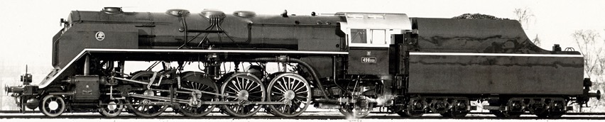

# Filip Havíř

  
   
  ČSD 498.001 „Albatros“ · photo: <a href="https://www.popluznidvur.cz">popluznidvur.cz</a>

DevOps / Cloud Engineer. Linux, automation and cloud infrastructure.

- ☁️ AWS (Certified Solutions Architect – Associate), Azure
- ☸️ Kubernetes, Docker
- 🔁 CI/CD: GitLab CI, GitHub Actions
- 🐍 Python, Bash
- Passionate developer :-)

### Contact

📫 [havirfilip@gmail.com](mailto:havirfilip@gmail.com) · [LinkedIn](https://cz.linkedin.com/in/filiphavir) · [filip-havir.netlify.app](https://filip-havir.netlify.app)
